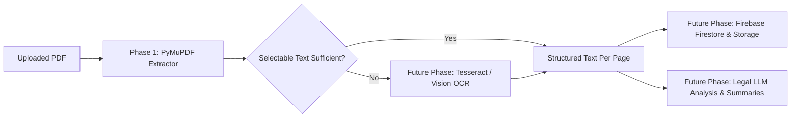

# NayaSetu Architecture Specification — Phase 1

## 1. System Overview

**NayaSetu** is an Indian court-document intelligence web application designed to ingest, process, and analyze complex judicial documents (orders, judgments, FIRs, charge sheets, and petitions).

Phase 1 establishes the core foundational infrastructure:
1. High-speed, in-memory PDF digital text extraction using PyMuPDF (`fitz`).
2. Detection and flagging of scanned or handwritten pages requiring OCR fallback.
3. Clean separation of concerns between API routes, validation schemas, and service logic.
4. Privacy-preserving processing: zero unnecessary disk persistence of uploaded documents.
5. Reactive TypeScript frontend with health check indicators and page-grouped text viewer.

```mermaid
flowchart TD
    Client["React + Vite Frontend (Port 5173)"]
    API["FastAPI Backend (Port 8000)"]
    Service["PDF Service (pdf_service.py)"]
    PyMuPDF["PyMuPDF (fitz) In-Memory Engine"]

    Client -->|1. GET /api/health| API
    Client -->|2. POST /api/documents/extract (multipart/form-data)| API
    API -->|3. Validate bytes & magic header| Service
    Service -->|4. In-memory parsing (fitz.open)| PyMuPDF
    PyMuPDF -->|5. Page text + character count| Service
    Service -->|6. Flag OCR requirement if text < threshold| API
    API -->|7. DocumentExtractionResponse (JSON)| Client
```

---

## 2. Component Architecture

### A. Frontend Layer (`frontend/`)
- **Technology**: React 18, Vite, TypeScript, Tailwind CSS, Lucide React.
- **Components**:
  - `Header`: Navigation, branding, and connectivity status.
  - `HealthStatusBadge`: Real-time polling and visual health indicator connecting to `GET /api/health`.
  - `DocumentUpload`: Drag-and-drop / file picker PDF dropzone with client-side file size and format validation (15 MB ceiling).
  - `ExtractedDocumentViewer`: Page-grouped text presentation, copy buttons, page search/filtering, and OCR requirement badges.
- **Service**:
  - `src/services/api.ts`: Typed Fetch API client reading `VITE_API_BASE_URL`.

### B. Backend Layer (`backend/app/`)
- **Framework**: FastAPI with Uvicorn ASGI server.
- **Configuration** (`app/core/config.py`):
  - Environment-based settings for upload limits (`MAX_UPLOAD_SIZE_BYTES`), OCR threshold (`OCR_THRESHOLD_CHARS`), and explicit CORS origins (`ALLOWED_ORIGINS`).
- **Schemas** (`app/schemas/document.py`):
  - Pydantic models for request/response validation: `HealthResponse`, `PageExtraction`, `DocumentExtractionResponse`.
- **Services** (`app/services/pdf_service.py`):
  - Pure Python service decoupled from FastAPI request handlers.
  - Validates `%PDF-` magic header (avoids trusting MIME type or file extensions).
  - Encrypted / password-protected document detection (`doc.is_encrypted`, `doc.needs_pass`).
  - Guaranteed memory cleanup using Python `finally` blocks and stream management.
- **Routes** (`app/api/routes/documents.py`):
  - Exception sanitization: ensures internal stack traces and server file paths are never leaked to clients.

---

## 3. Future Integration Roadmap (Phase 2+)

The Phase 1 architecture is modular and specifically designed for non-breaking extensions:



1. **OCR Engine Integration**:
   - For pages flagged with `requires_ocr=True`, integrate an asynchronous OCR processing pipeline (e.g., Tesseract OCR or cloud vision engine).
2. **Cloud Persistence (Firebase Firestore & Firebase Storage)**:
   - Optional authenticated document storage and structured metadata tracking for case files.
3. **Legal Intelligence / LLM API**:
   - Contextual extraction of IPC / BNS sections, FIR dates, judge names, petitioner/respondent entities, and dispositive holdings.
4. **Legal Data APIs**:
   - External registry lookups (eCourts / High Court cause lists).
