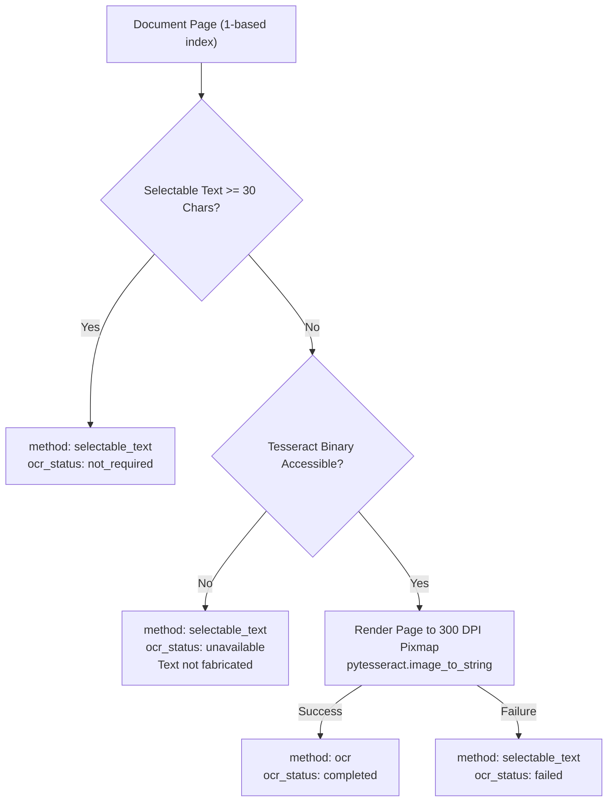

# NayaSetu — Phase 2: OCR and Document Intelligence Foundation Report

## 1. Scope & Acceptance Criteria

Phase 2 builds upon the working Phase 1 foundation by integrating optical character recognition (OCR) for scanned court documents, standardizing document text representation, and establishing structured evidence referencing.

### Acceptance Criteria Checklist
- [x] Inspect existing repository, branch (`feature/phase-1-foundation`), and clean working tree before editing.
- [x] Preserve all working Phase 1 features and backward compatibility of existing API contracts.
- [x] Implement selective OCR using Tesseract for pages with sparse or non-selectable text (`char_count < OCR_THRESHOLD_CHARS`).
- [x] Avoid running OCR unnecessarily on pages that already contain high-quality digital text.
- [x] Check for Tesseract executable presence on system PATH, standard Windows install paths, or via `TESSERACT_CMD`.
- [x] Clearly document that installing `pytesseract` Python library alone does not install the OS binary.
- [x] Clearly distinguish between `selectable_text` and `ocr` in page metadata.
- [x] Return explicit `ocr_status` (`not_required`, `completed`, `unavailable`, `failed`).
- [x] When Tesseract is absent on the host, return a safe, actionable `unavailable` status without faking OCR results or leaking internal server traces.
- [x] Preserve original 1-based page ordering for mixed documents (containing both scanned and text pages).
- [x] Add continuous normalized document text representation (`normalized_full_text`) preserving page demarcations.
- [x] Add grounded evidence reference models (`sample_evidence_references`) linking excerpts to source pages and character offsets without fabricating AI claims.
- [x] Update frontend with OCR indicators, page-level badges, normalized text viewer, and evidence reference tabs.
- [x] Update `backend/requirements.txt` with pinned `pytesseract==0.3.13` and `pillow==12.0.0`.
- [x] Implement comprehensive automated test suite with mocked OCR tests and optional real Tesseract integration test.

---

## 2. Technical Design & Implementation

### A. Selective OCR Workflow
Rather than running expensive OCR over every page of a multi-page PDF:
1. PyMuPDF loads each page and extracts digital text using `page.get_text("text")`.
2. If `len(text.strip()) >= OCR_THRESHOLD_CHARS` (default 30 characters), the page is marked `extraction_method="selectable_text"` and `ocr_status="not_required"`.
3. If `len(text.strip()) < OCR_THRESHOLD_CHARS`, the page is flagged `requires_ocr=True`.
4. Only flagged pages are rendered to high-resolution in-memory pixmaps (`dpi=300`), converted to PNG byte streams, and sent to Tesseract.
5. If Tesseract is not installed on the host machine, the page safely records `ocr_status="unavailable"` and `ocr_unavailable=True`, preserving whatever sparse text was available.



### B. Normalized Full Text
For downstream legal intelligence and LLM processing (Phase 3), the API synthesizes a continuous representation with explicit page demarcations:
```text
--- [Page 1] ---
IN THE HIGH COURT OF JUDICATURE AT BOMBAY
CRIMINAL APPELLATE JURISDICTION

--- [Page 2] ---
ORDER DATED 14TH AUGUST 2024
```

### C. Grounded Evidence References
The schema introduces `EvidenceReference`:
```json
{
  "page_number": 1,
  "passage": "IN THE HIGH COURT OF JUDICATURE AT BOMBAY...",
  "start_char": 0,
  "end_char": 42,
  "extraction_method": "selectable_text"
}
```
Passages are extracted strictly from verbatim page text with character boundary offsets.

---

## 3. Tesseract OCR Installation Guide for Windows

> [!IMPORTANT]
> The Python package `pytesseract` is a wrapper around the standalone Tesseract binary. It does **not** install the Tesseract executable itself.

### Steps to Install Tesseract on Windows:
1. Download the Windows 64-bit installer from the official UB-Mannheim repository:
   - URL: `https://github.com/UB-Mannheim/tesseract/wiki`
2. Run the installer. Default installation directory:
   - `C:\Program Files\Tesseract-OCR\tesseract.exe`
3. Optional: Select additional language packs (e.g., Hindi `hin.traineddata`) during installation.
4. Configure in `backend/.env`:
   ```env
   TESSERACT_CMD=C:\Program Files\Tesseract-OCR\tesseract.exe
   OCR_LANGUAGES=eng
   ```
5. If added to system PATH, NayaSetu auto-detects `tesseract.exe` without explicit configuration.

---

## 4. Files Created and Modified

```
Error_202_legal/
├── backend/
│   ├── .env.example                       # Added TESSERACT_CMD and OCR_LANGUAGES
│   ├── requirements.txt                   # Added pytesseract==0.3.13, pillow==12.0.0
│   └── app/
│       ├── core/config.py                 # Added TESSERACT_CMD and OCR_LANGUAGES settings
│       ├── main.py                        # Health check updated with ocr_available
│       ├── schemas/
│       │   ├── __init__.py                # Exported new Phase 2 models
│       │   └── document.py                # Added ExtractionMethod, OCRStatus, EvidenceReference
│       └── services/
│           ├── __init__.py                # Exported OCR service functions
│           ├── ocr_service.py             # NEW: Tesseract resolution, validation & execution
│           └── pdf_service.py             # Targeted OCR dispatch, normalized text & evidence
│   └── tests/
│       ├── test_health.py                 # Health check assertions for ocr_available
│       └── test_pdf_extraction.py         # Added tests for OCR, missing Tesseract, and mixed PDFs
├── frontend/
│   └── src/
│       ├── types/document.ts              # Phase 2 TypeScript interfaces
│       ├── components/
│       │   ├── Header.tsx                 # Phase 2 branding
│       │   ├── HealthStatusBadge.tsx      # Real-time OCR binary readiness pill
│       │   └── ExtractedDocumentViewer.tsx# Page badges, OCR alert, Normalized & Evidence tabs
│       └── App.tsx                        # Phase 2 feature highlights
├── docs/
│   ├── ARCHITECTURE.md                    # Updated with Phase 2 data flows
│   └── PHASE_2.md                         # This implementation report
└── README.md                              # Updated with Phase 2 capabilities & setup guide
```

---

## 5. Automated Test Results

The backend test suite (`python -m pytest -v`) was executed:
- **Total tests**: 11
- **Passed**: 10
- **Skipped**: 1 (`test_real_tesseract_engine_integration` correctly skipped because Tesseract binary is not installed on this host)
- **Time**: 1.66s
- **Pass rate**: **100% of applicable tests passed**

---

## 6. How Phase 2 Powers Future Phase 3 (Legal Intelligence)

1. **Clean Input Stream**: The `normalized_full_text` output provides a clean, single-document payload formatted with consistent page markers ready for chunking and token counting.
2. **Citation Grounding**: When Phase 3 extracts legal entities (FIR sections, judges, petitioners, bail orders), it can attach them directly to `EvidenceReference` records containing exact 1-based page numbers and character ranges for user auditability.
