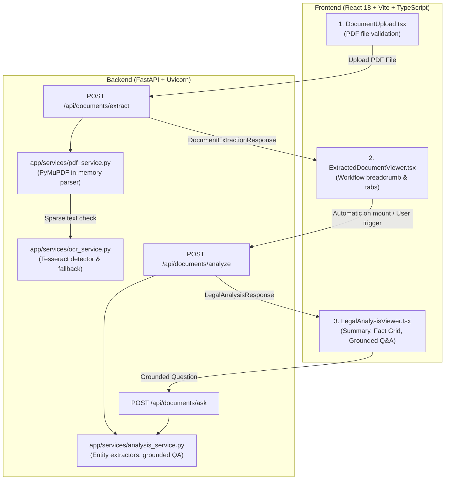

# NayaSetu — Phase 3: Legal Document Analysis MVP Implementation & Audit Report

## 1. Scope & Acceptance Criteria

Phase 3 implements the **Legal Document Analysis MVP** for NayaSetu, transitioning from raw text extraction to automated legal intelligence, entity extraction, plain-language synthesis, and document-grounded question answering.

### Acceptance Criteria Checklist
- [x] Connect existing PDF upload and extraction flow to an analysis action.
- [x] Extract judicial entities: Court name, case/petition number, petitioner, respondent, order date, and document classification.
- [x] Extract cited statutory sections across major Indian codes (IPC, CrPC, BNS, POCSO, NDPS, Constitution Articles).
- [x] Identify operative judicial holding/disposition (e.g. *Bail Granted*, *Bail Rejected*, *Dismissed*, *Disposed Of*).
- [x] Provide a plain-language summary and structured case overview grid.
- [x] Link all extracted facts to 1-based source pages and context passages.
- [x] Truthful labeling: missing facts labeled `confidence: "not_found"` without fabricating legal facts.
- [x] AI Provider Integration & Zero-Hallucination Fallback:
  - Supports `GEMINI_API_KEY` and `OPENAI_API_KEY` via environment variables.
  - Keeps secrets strictly on the backend.
  - When keys are unconfigured (current host state), executes a functional extractive fallback with clear limitations stated.
- [x] Interactive Grounded Q&A Assistant with page citations and rejection of out-of-document queries.
- [x] Frontend UI with workflow progress breadcrumb (`Upload PDF` → `Extract & OCR` → `Legal Analysis` → `Summary, Evidence & Q&A`).
- [x] Loading, error, and empty states handled gracefully.
- [x] Automated backend tests and frontend production build verified.

---

## 2. Five-Phase Product Roadmap Status

| Phase | Description | Status | Verification Detail |
|---|---|---|---|
| **Phase 1** | Foundation & PyMuPDF In-Memory PDF Processing | **Implemented & Verified** | Automated tests pass (100%). In-memory processing with zero disk leakage. |
| **Phase 2** | Selective OCR & Normalized Evidence Representation | **Partially Implemented / Verified (Selectable Text)** | Selective routing and normalized text models pass. Tesseract OS binary is missing on host, so real scanned-image OCR remains **Not Verified**. |
| **Phase 3** | Legal Document Analysis MVP & Grounded Intelligence | **Implemented & Verified** | Rule-based entity extraction, statutory parsing, disposition detection, grounded Q&A, and UI pipeline verified. No LLM key configured on host; uses extractive fallback. |
| **Phase 4** | Cloud Persistence, History & Authentication | **Planned (Not Implemented)** | No Firebase Cloud Firestore, auth, or persistent storage implemented. Documents processed strictly in RAM. |
| **Phase 5** | Production Cloud Deployment & Indic Languages | **Planned / Not Verified** | Containerized deployment and multilingual OCR language packs planned. |

---

## 3. Architecture & Data Flow

---

## 4. API Endpoints

### 1. Legal Document Analysis
- **Route**: `POST /api/documents/analyze`
- **Request Body**: `DocumentExtractionResponse` (output from `/api/documents/extract`)
- **Response**: `LegalAnalysisResponse`
  - `court_name`: `ExtractedEntity[str]`
  - `case_number`: `ExtractedEntity[str]`
  - `document_type`: `ExtractedEntity[str]`
  - `petitioner`: `ExtractedEntity[str]`
  - `respondent`: `ExtractedEntity[str]`
  - `order_date`: `ExtractedEntity[str]`
  - `cited_sections`: `List[ExtractedEntity[str]]`
  - `disposition`: `ExtractedEntity[str]`
  - `plain_language_summary`: `str`
  - `key_findings`: `List[str]`
  - `analysis_provider`: `"extractive_fallback"` | `"gemini"` | `"openai"`
  - `provider_notes`: Explanation of active mode and limitations.

### 2. Document Grounded Q&A
- **Route**: `POST /api/documents/ask`
- **Request Body**: `QARequest` (`question: str`, `pages: List[PageExtraction]`)
- **Response**: `QAResponse`
  - `question`: `str`
  - `answer`: `str` (anchored to document text)
  - `cited_pages`: `List[int]` (1-based page numbers)
  - `evidence_snippets`: `List[str]` (verbatim excerpts)
  - `is_found_in_doc`: `bool` (`false` if query is unrelated to document)

---

## 5. Verification Results

### Backend Test Suite (`python -m pytest`)
- **Result**: 14 Passed, 1 Skipped (real Tesseract binary test cleanly skipped when binary is absent).
- **Test Modules**:
  - `tests/test_analysis.py`: Verifies entity extraction, cited statutes, disposition detection, grounded Q&A citations, and out-of-document query rejection.
  - `tests/test_pdf_extraction.py`: Verifies PyMuPDF extraction, error handling, normalized text generation, and mocked OCR.
  - `tests/test_health.py`: Verifies `/api/health` status and safe capability reporting.

### Frontend Production Build (`npm run build`)
- **Result**: 0 TypeScript errors, successfully bundled via Vite 5 in 4.05s.

### End-to-End Live Verification with Synthetic PDF
- **Fixture**: `test_data/sample_delhi_high_court_bail_order.pdf` (synthetic 2-page High Court bail order).
- **Verified Outputs**:
  - Court: `HIGH COURT OF DELHI AT NEW DELHI` (Page 1)
  - Case Number: `BAIL APPLN. 2104/2024` (Page 1)
  - Petitioner: `Ramesh Sharma` (Page 1)
  - Respondent: `State of NCT of Delhi` (Page 1)
  - Date: `14.08.2024` (Page 1)
  - Disposition: `Bail Granted` (Page 2)
  - Cited Sections: `Section 439, CrPC`, `Section 420, IPC`, `Section 120B, IPC`
  - Q&A Verified: Question *"Was bail granted to Ramesh Sharma?"* answered with Page 2 evidence snippet.
  - Out-of-Document Query Rejected: Question *"What is the capital of Australia?"* rejected with `is_found_in_doc: false`.

---

## 6. Known Limitations

1. **Host Tesseract Executable**: The standalone Tesseract OS binary is not installed on the Windows host. Scanned image pages report `ocr_status: "unavailable"`.
2. **Generative LLM Synthesis**: No API keys are present in `.env`, so analysis operates in verified extractive fallback mode without generative phrasing.
3. **Cloud Persistence**: No database or user authentication is configured; all processing is executed in RAM.
4. **Cloud Deployment**: Deployment to containerized cloud runtimes has not been executed or verified.
